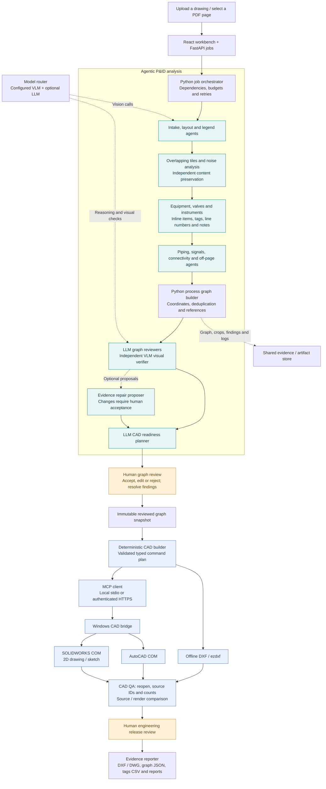

# LineaForge Studio — Beta

A **human-supervised agentic AI application** for P&ID digitization and PDF/CAD conversion, built with React and Python/FastAPI. An orchestrator coordinates specialist vision, reasoning, verification, and CAD roles over shared evidence. Configure your own VLM, LLM, and CAD MCP connection, then run locally on Windows or deploy the web service with a separate Windows CAD workstation.

**Beta status:** software workflows and offline DXF output have been exercised with synthetic fixtures and recorded model responses. Real recognition accuracy and licensed AutoCAD/SOLIDWORKS generation require acceptance testing with your models, drawings, and software versions. Connection success does not establish engineering accuracy.

## Features

- **P&ID Studio:** source previews, overlapping detail tiles, symbols/text/connections, noise evidence, editable graph, human review, CAD export, and QA findings.
- **28 specialist roles:** 19 VLM, 4 LLM, and 5 deterministic Python roles sharing configured endpoints. Repair proposals are opt-in; 27 roles are enabled by default.
- **Agent Studio:** role selection, routing, prompt overrides, bounded parallel calls, budgets, and an evidence timeline.
- **Connections:** OpenAI-compatible VLM/LLM endpoints, offline DXF, AutoCAD/SOLIDWORKS MCP, and optional external DWG conversion.
- **Drawing Converter / PDF Tools:** PDF/DXF conversion and PDF merge, split, compress, and organize.
- **Traceability:** reviewed snapshots, source IDs, tags CSV, review reports, CAD comparisons, and transmission audit hashes.

[Full technical diagram](docs/diagrams/lineaforge-technical-ecosystem.png) · [Editable SVG](docs/diagrams/lineaforge-technical-ecosystem.svg) · [Beta overview](docs/diagrams/lineaforge-linkedin-beta-1200x1500.png)

## Agentic workflow

The Python orchestrator schedules specialist tasks in dependency order. Vision roles interpret drawings; language roles review structured graph evidence and CAD readiness. Each model response passes a JSON/Pydantic contract before entering the shared graph. Source IDs, image crops, findings, and human decisions remain traceable through CAD delivery.



The analysis job prepares evidence for review. CAD generation is a separate job that consumes an immutable snapshot of the approved graph. Only the deterministic builder issues CAD commands. The software retains a human review status after CAD QA; comparisons do not automatically certify engineering fidelity. Independent DWG visual comparison requires a reviewed native plot or DXF export.

### Specialist agent ecosystem

| Stage | Roles | Execution |
| --- | --- | --- |
| Control — 1 | Job orchestrator | Python |
| Understand — 3 | Intake classifier; global layout analyst; legend & standard expert | VLM |
| Preserve — 2 | Noise analyst; content preservation verifier | VLM decisions + local image operations |
| Extract — 7 | Equipment; valves; instrumentation; inline components; tag & text; line numbers; notes & tables | VLM |
| Connect — 4 | Piping tracer; signal tracer; connectivity analyst; off-page & tie-in analyst | VLM |
| Validate — 6 | Process graph builder; topology reviewer; tag & loop reviewer; piping consistency reviewer; independent visual verifier; optional evidence repair proposer | 1 Python + 3 LLM + 2 VLM |
| Deliver — 5 | CAD build planner; MCP CAD builder; CAD render verifier; human release gate; evidence reporter | 1 LLM + 1 VLM + 3 Python; CAD QA also uses structural checks |

**28 roles = 19 VLM + 4 LLM + 5 Python.** They share configured providers. The repair proposer is opt-in, leaving **27 roles enabled by default**. The current dependency batches allow up to four concurrent specialist calls. If no LLM model is configured, its reasoning roles fall back to the VLM.

### Agent coordination and review

- **Task handoffs:** overview conventions guide tile specialists; extracted elements give connectivity agents stable IDs; graph findings identify regions for fresh visual verification.
- **Shared state:** schema-validated responses, cached evidence, source coordinates, graphs, event logs, and review decisions connect the stages.
- **Bounded execution:** Python enforces call/time/estimated-cost budgets, cancellation, retries, required roles, and dependency ordering. Configure routing and prompts in Agent Studio.
- **Evidence-based correction:** the repair role proposes changes for human review. Unreadable tags remain flagged; proposed repairs are never silently applied.
- **Controlled tool use:** CAD commands are preflighted against the selected MCP tool schemas and output root. Native CAD runs on the licensed Windows host.
- **Human approval:** review must resolve findings and classify elements as accepted or rejected, with at least one accepted element. Unreadable content needs correction or rejection before CAD submission; engineering release remains a human decision.

## Run on Windows

Install **Python 3.12 or 3.13** and **Node.js 24**, then:

```powershell
git clone https://github.com/pmbhatiya97/P-id_pdf_to_CAD.git
Set-Location P-id_pdf_to_CAD
.\Start-LineaForge.cmd
```

The source launcher prepares a Python environment, installs pinned web dependencies, builds React if needed, starts FastAPI, and opens **http://127.0.0.1:8765**. The first run needs internet access. Compiled React and the API share one server.

Manual startup:

```powershell
python -m venv .venv
.\.venv\Scripts\python.exe -m pip install -r requirements-web.txt
Set-Location web
npm.cmd ci
npm.cmd run build
Set-Location ..
.\.venv\Scripts\python.exe -m lineaforge.web_launcher --open
```

Data defaults to `%USERPROFILE%\.lineaforge\web`. Set `LINEAFORGE_DATA_DIR` to select another directory. The launcher reuses an existing healthy local instance.

This repository contains source code. Portable executables, model weights, private drawings/reference crops, evaluation annotations, local settings, and credentials are excluded.

## Configure VLM and LLM

Open **Connections → Models** and enter the base URL, exact model ID, and optional key.

- The VLM must accept image inputs through an OpenAI-compatible `/chat/completions` endpoint and return schema-conforming JSON.
- The optional LLM handles graph reviewers and the CAD planner; an empty LLM model falls back to the VLM.
- Local mode accepts literal loopback addresses, such as `http://127.0.0.1:8000/v1`. Other hosts require cloud mode and explicit per-job external-transfer consent.
- Connection tests check model discovery, rather than recognition accuracy. Inspect representative drawings and evidence next.

Keys stay in the backend's local configuration and are redacted from public API responses. Protect the data directory. Model weights and CAD licenses are supplied separately.

## Connect CAD through MCP

Open **Connections → CAD**:

| Backend | Requirements | Result |
| --- | --- | --- |
| Offline DXF | No native CAD application | Editable DXF through ezdxf |
| AutoCAD | Licensed, logged-in Windows application | Native layers, blocks, attributes, DWG/DXF |
| SOLIDWORKS | Licensed Windows application and drawing template | 2D drawing/sketch exported as DWG/DXF |

Choose **stdio** for the bundled local bridge or authenticated **HTTPS MCP** for a separate Windows workstation. A custom server must match the typed tool contract. Only the deterministic builder executes reviewed geometry; extraction agents do not independently edit CAD.

Human review is required before CAD submission and after QA. SOLIDWORKS support is for 2D drawings, rather than a 3D plant or Electrical project. See the [CAD/MCP setup guide](docs/web_cad_setup.md) for templates, transports, tools, and artifact retrieval.

## Deploy

```powershell
$env:LINEAFORGE_API_TOKEN = python -c "import secrets; print(secrets.token_urlsafe(32))"
docker compose up --build -d
```

Compose binds `127.0.0.1:8765` and persists its workspace in a volume. Enter the generated token in the browser. For team access, use an authenticated HTTPS reverse proxy. Native CAD stays on a licensed Windows workstation behind a protected bridge.

Docker configuration is provided but was not executed in this environment. The current service supports one trusted workspace and one ASGI process, with two bounded job workers. Tenant isolation, SSO/RBAC, and distributed scheduling are absent.

## Development and verification

```powershell
python -m pip install -e ".[build]"
python -m pytest -q
Set-Location web
npm.cmd ci
npm.cmd run build
```

Native CAD tests are opt-in. Tests requiring excluded private evaluation data skip explicitly. Synthetic and recorded-response tests verify software behavior, not recognition accuracy.

- [Web setup and deployment](docs/web_product.md)
- [Architecture](docs/architecture.md)
- [Verification evidence and acceptance limits](docs/web_test_report.md)
- [Current limitations](docs/limitations.md)

## Build a portable Windows package

```powershell
.\scripts\build_web.ps1 -Python python
```

Builds create timestamped application folders and source/portable ZIPs under `dist/`. Keep the executable, `_internal` directory, CAD bridge executable, and launchers together. External CAD applications, model weights, and DWG utilities are not bundled. Windows builds are unsigned.

## Structure

```text
lineaforge/       FastAPI, jobs, models, agents, conversion, CAD/MCP and QA
web/              React + TypeScript workbench
schemas/          Structured extraction and graph contracts
tests/            Synthetic, protocol, review, conversion and API checks
docs/             Setup, architecture, limitations and diagrams
scripts/          Launch, build and packaging helpers
installer/        Optional Windows installer definition
landing/dist/     Original static landing-page source
```

Private drawing evidence and runtime data stay outside published source. Review upstream dependency licenses before commercial distribution, including PyMuPDF, PySide6/Qt, and any separately installed DWG utility.
